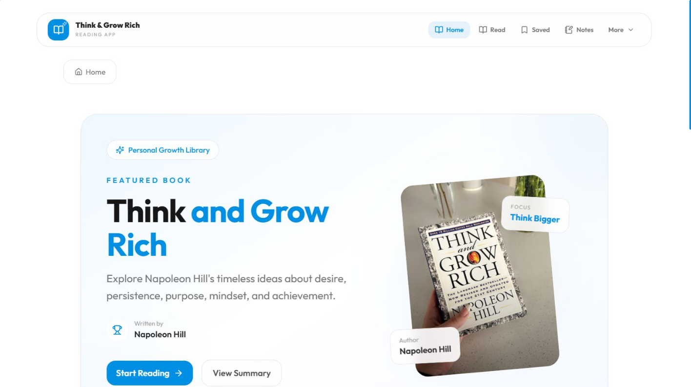

# 📚 Think & Grow Rich — Chapter Reader

A modern, responsive chapter-reading application built for reading **Think & Grow Rich** with a clean interface, smooth animations, chapter navigation, bookmarks, notes, and personalized reading features.

The frontend is built with **React.js**, **React Router**, **Tailwind CSS**, **Axios**, **Framer Motion**, and **Lucide React**, and communicates with an **Express.js backend** that retrieves persistent chapter data from **Supabase**.



---

## ✨ Features

* 📖 Read individual chapters
* 📚 Browse available chapters
* 🔗 Navigate between chapters
* 📌 Bookmark chapters
* 📝 Create and manage notes
* 🎨 Theme preferences
* 🪄 Smooth UI animations
* 🔘 Floating action menu
* 🧭 Custom 404 Not Found page
* 📱 Fully responsive design
* ⚡ Fast client-side navigation
* 🔌 Express.js API integration
* ☁️ Supabase-backed chapter data
* 🔗 External links open in a new tab

---

## 🧠 Tech Stack

### Frontend

* **React.js**
* **React Router**
* **Tailwind CSS**
* **Axios**
* **Framer Motion**
* **Lucide React**

### Backend

* **Node.js**
* **Express.js**
* **Supabase**
* **PostgreSQL**

The frontend does not communicate directly with Supabase.

The application uses:

```text
React Frontend
      ↓
Axios
      ↓
Express API
      ↓
Supabase
```

---

# 🏗️ Project Architecture

```text
┌──────────────────────────┐
│        React App         │
│                          │
│  Pages / Components      │
│  React Router            │
│  Tailwind CSS            │
└────────────┬─────────────┘
             │
             │ Axios
             ▼
┌──────────────────────────┐
│      Express Server      │
│                          │
│      REST API            │
└────────────┬─────────────┘
             │
             │ Supabase Query
             ▼
┌──────────────────────────┐
│        Supabase          │
│                          │
│      PostgreSQL          │
│        chapters          │
└──────────────────────────┘
```

The frontend is responsible for the user interface.

The Express backend is responsible for communicating with Supabase.

Supabase is responsible for persistent data storage.

---

# 📁 Project Structure

```text
Think-and-Grow-Rich-client/
│
├── public/
│
├── src/
│   ├── components/
│   │
│   ├── pages/
│   │
│   ├── routes/
│   │
│   ├── assets/
│   │
│   ├── App.jsx
│   ├── main.jsx
│   └── ...
│
├── .gitignore
├── package.json
├── package-lock.json
├── vite.config.js
└── README.md
```

---

# 🔧 Installation

## 1. Clone the Repository

```bash
git clone https://github.com/ibhimwhar/Think-and-Grow-Rich-client.git
```

Navigate into the project:

```bash
cd Think-and-Grow-Rich-client
```

---

## 2. Install Dependencies

```bash
npm install
```

---

## 3. Start the Frontend

```bash
npm run dev
```

The frontend will normally run at:

```text
http://localhost:5173
```

---

# 🖥️ Backend Setup

This frontend requires the **Think & Grow Rich Express backend** to be running.

Clone the backend repository separately:

```bash
git clone https://github.com/ibhimwhar/Think-and-Grow-Rich-server.git
```

Navigate into it:

```bash
cd Think-and-Grow-Rich-server
```

Install dependencies:

```bash
npm install
```

Configure the backend `.env` file:

```env
SUPABASE_URL=your_supabase_url
SUPABASE_SERVICE_ROLE_KEY=your_supabase_service_role_key
PORT=5000
```

Start the backend:

```bash
npm run dev
```

The backend should then be available at:

```text
http://localhost:5000
```

---

# 🔌 API Connection

The frontend communicates with the Express backend through HTTP requests.

For example, chapters are retrieved using:

```http
GET http://localhost:5000/chapters
```

The request flow is:

```text
User opens chapter page
        ↓
React component
        ↓
Axios request
        ↓
Express /chapters
        ↓
Supabase
        ↓
Chapter data
        ↓
Express
        ↓
React
        ↓
User sees chapter
```

---

# 📖 Chapters

Chapter data is stored in Supabase rather than inside the frontend.

The frontend retrieves the data through the Express API.

Example response:

```json
[
  {
    "id": "uuid",
    "title": "WHAT DO YOU WANT MOST?",
    "description": "The Thirteen Steps to Riches..."
  },
  {
    "id": "uuid",
    "title": "PUBLISHER'S PREFACE",
    "description": "THIS book conveys..."
  }
]
```

This allows the frontend to remain independent from the database.

---

# 📌 Bookmarks

Users can bookmark chapters through the backend API.

### Get bookmarks

```http
GET /bookmarks
```

### Add bookmark

```http
POST /bookmarks/:chapterId
```

### Delete bookmark

```http
DELETE /bookmarks/:chapterId
```

The frontend displays visual feedback when a chapter is bookmarked.

> Bookmarks are currently stored in the backend's temporary in-memory storage and will eventually be moved to Supabase for persistent user-specific storage.

---

# 📝 Notes

The application supports creating and deleting notes.

### Get notes

```http
GET /notes
```

### Create note

```http
POST /notes
```

Example:

```json
{
  "title": "My Note",
  "content": "Important idea from this chapter."
}
```

### Delete note

```http
DELETE /notes/:id
```

> Notes are currently stored in backend memory and will eventually be persisted in Supabase.

---

# 🎨 Theme

The application supports theme preferences.

### Get theme

```http
GET /theme
```

### Save theme

```http
POST /theme
```

Example:

```json
{
  "theme": "dark"
}
```

Theme functionality can later be connected to authenticated users and stored permanently in Supabase.

---

# 🧭 Routing

The application uses React Router for client-side navigation.

Example routes include:

```text
/
├── Home
│
├── /chapters
│   └── Chapter list
│
├── /chapters/:id
│   └── Individual chapter
│
├── /bookmarks
│   └── Saved chapters
│
├── /notes
│   └── User notes
│
└── *
    └── 404 Not Found
```

---

# ⚡ Development Workflow

You need both the frontend and backend running during development.

### Terminal 1 — Backend

```bash
cd Think-and-Grow-Rich-server
npm install
npm run dev
```

Backend:

```text
http://localhost:5000
```

### Terminal 2 — Frontend

```bash
cd Think-and-Grow-Rich-client
npm install
npm run dev
```

Frontend:

```text
http://localhost:5173
```

---

# 🌱 Database Seeding

The frontend does **not** seed the database.

Database seeding is handled by the backend.

From the backend project:

```bash
npm run seed
```

The flow is:

```text
Backend data.js
      ↓
seed.js
      ↓
Supabase
```

After the data has been seeded, the frontend retrieves the chapters through Express.

```text
Supabase
      ↓
Express API
      ↓
React Frontend
```

---

# 🔐 Security

The frontend does not contain the Supabase service-role key.

Never add this to the React application:

```text
SUPABASE_SERVICE_ROLE_KEY
```

The service-role key must remain on the backend.

The correct architecture is:

```text
React
  ↓
Express
  ↓
Supabase
```

Not:

```text
React
  ↓
Supabase Service Role Key
  ↓
Supabase
```

---

# 🌐 CORS

During local development, the frontend and backend run on different ports.

Example:

```text
Frontend → http://localhost:5173
Backend  → http://localhost:3000
```

The Express backend must allow requests from the frontend.

Example backend configuration:

```js
const cors = require("cors");

app.use(
  cors({
    origin: "http://localhost:5173",
  })
);
```

---

# 📦 Build for Production

Create a production build:

```bash
npm run build
```

Preview the production build locally:

```bash
npm run preview
```

---

# 🚀 Production Architecture

When deployed, the architecture will look like:

```text
                    Internet
                       │
                       ▼
              ┌────────────────┐
              │ React Frontend │
              └───────┬────────┘
                      │
                      │ HTTPS
                      ▼
              ┌────────────────┐
              │ Express Backend│
              └───────┬────────┘
                      │
                      │ Secure API
                      ▼
              ┌────────────────┐
              │    Supabase    │
              │   PostgreSQL   │
              └────────────────┘
```

---

# 🛠️ Available Commands

| Command           | Description                  |
| ----------------- | ---------------------------- |
| `npm install`     | Install dependencies         |
| `npm run dev`     | Start the development server |
| `npm run build`   | Create a production build    |
| `npm run preview` | Preview the production build |

---

# 🔮 Future Improvements

Planned features include:

* 🔐 User authentication
* 👤 User profiles
* 📖 Reading progress
* 📌 Persistent bookmarks
* 📝 Persistent notes
* ✨ Text highlighting
* 🔎 Chapter search
* 📊 Reading statistics
* 🌓 Advanced themes
* 🤖 AI-powered chapter summaries
* 🤖 AI reading assistant
* 📱 Improved mobile reading experience
* ☁️ Persistent user preferences
* 🔒 User-specific database permissions

---

## 🚀 Quick Start

If the backend is already configured and the database has been seeded:

### Backend

```bash
cd Think-and-Grow-Rich-server
npm install
npm run dev
```

### Frontend

Open another terminal:

```bash
cd Think-and-Grow-Rich-client
npm install
npm run dev
```

Then open:

```text
http://localhost:5173
```

The application should now be running with:

```text
React
  ↓
Express
  ↓
Supabase
```

and users can read the chapter content stored in the database.